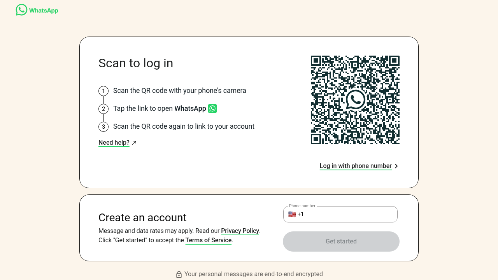

# 001: What actually happens when WhatsApp Web loads, before you scan the QR code?

You open web.whatsapp.com, see a QR code, and nothing seems to happen until you scan it. That is not what the capture shows.

 Before you touch your phone, the page has already loaded a small operating system for messaging and opened an encrypted channel to WhatsApp's servers.

Everything below comes from one recorded page load on 2026-10-20 (fresh profile, no login), captured and analyzed with [REA](https://github.com/morluto/rea). The evidence excerpt with every event referenced here is in [evidence-excerpt.json](evidence-excerpt.json).

## What the page actually downloads

The first document is a small shell. The real app is JavaScript pulled from `static.whatsapp.net` (Meta's static CDN), versioned by build (`__spin_r=1050956675` at capture time). The page then fetches a bundle manifest (`static.whatsapp.net/btmanifest/1050956675/whatsapp/main`) and keeps pulling named modules on demand through a bootloader endpoint (`web.whatsapp.com/ajax/bootloader-endpoint/?modules=...`). Modules observed loading lazily, only when needed: `WAWebLocalesCldrEmojiSuggestionEn`, `WAWebToastManagerImpl`, `WAWebCountriesLocaleEN`, `WDSLoadRobotoVariableFont`.

So the app you "load" is never one big download. It arrives piece by piece, as features are reached.

## The app does not run on the page's main thread

Two dedicated Web Workers are created at startup (`webworker_v1` and `webworker_v4` with `worker_type=MODULE`). The main messaging logic is explicitly loaded into a worker: the page POSTs to `web.whatsapp.com/static_resources/webworker_v4/rsrc/?worker_module=WAWebBackendWorkerV2Bundle`, a module literally named the backend worker.

Verified: the heavy backend of WhatsApp Web runs in a background worker, not the UI thread. That is how the UI stays responsive while crypto and sync work happen. A service worker (`sw.js`) is also registered, and the web app manifest (`display: standalone`) confirms it is built to behave like an installed app.

## It opens the encrypted chat channel before you log in

The single most interesting observation: during the QR screen, with no account linked, the page opens a WebSocket to `wss://web.whatsapp.com/ws/chat`. One frame was sent (43 bytes) and one received (350 bytes) during the capture window.

The QR code is not a login form. The page is already talking to WhatsApp's servers over the same channel that will later carry your messages; the QR scan only authorizes the session on that existing channel.

**(inferred)** The 43-byte first frame is consistent with the start of a Noise protocol handshake, which is the documented design of WhatsApp's web client protocol. The frame contents were not decrypted here, so this specific identification is inference, not observation.

Supporting observation from storage: before any login, the page has already written `WANoiseInfo`, `WANoiseInfoIv`, `WAWebEncKeySalt`, and `WebEncKeySalt` to localStorage. Key material for the channel exists on disk before you scan anything.

## What it stores before you scan

Cookies set on first visit: `wa_ul` (HttpOnly, Secure) and `wa_web_lang_pref`.

localStorage keys written pre-login: `WAUnknownID`, `RSTData`, `WANoiseInfo`, `WANoiseInfoIv`, `WALangPhonePref`, `WAWebWAMBeaconingSettings`, `WAWebEncKeySalt`, `WebEncKeySalt`, `Session`, `banzai:last_storage_flush`, `whatsapp-mutex`.

Plain-English reading of the names:

- `whatsapp-mutex`: a lock so two browser tabs do not run the same account at once.
- `banzai:last_storage_flush`: Banzai is Meta's internal analytics pipeline name; this is a bookkeeping key for telemetry flushing. Related: a POST to `web.whatsapp.com/ajax/bz`, Meta's known analytics endpoint, fires during load.
- `WAWebWAMBeaconingSettings`: settings for WhatsApp Metrics (WAM) beacons.

The page also asked the browser for persistent storage and was denied in this environment: the console shows `[storage] storage bucket persistence denied` from Meta's ErrorUtils. Verified: WhatsApp Web wants durable, eviction-proof local storage for your messages, and falls back when the browser refuses.

## Smaller observations

- The site's Permissions-Policy header references features this Chrome build did not recognize (`attribution-reporting`, `bluetooth`, `shared-storage`, `shared-storage-select-url`), so the browser logged warnings. The page is written against newer web platform capabilities than stable Chrome ships.
- Emoji are served as pre-rendered WebP sprite sheets, not font glyphs.
- Two fonts and a handful of WebP images complete the first paint.

## What this capture could not verify

- The contents of the WebSocket frames. They are binary and encrypted; only sizes and timing are reported here.
- What happens after the QR scan. This capture is deliberately unauthenticated.
- Deeper static structure of the largest JS bundles. About 937 KB of script source was captured and REA's static analysis parsed the smaller bundles fully (44k AST nodes), but the two largest bundles exceeded this environment's analysis budget. Their internals are marked **(unknown)**, not guessed.

## Evidence

- [qr-screen.png](qr-screen.png): the page as rendered at the end of the capture (sha256 `0cf82ca4e1bdfcffe9308307de11da353f150d27022a34463fb9290281ca9d31`).

- [evidence-excerpt.json](evidence-excerpt.json): every network transaction, worker, WebSocket event, console message, and storage key observed, in capture order. Response bodies and header values are omitted by design; the full capture retains them locally as digests.
- Tooling: REA `capture-browser-scenario` (Chrome 154, headless, fresh profile, 40 s observation window) and `analyze-javascript-application` for the static pass.

## Why this matters

The QR screen looks like a locked door. It is actually a running machine: encrypted channel open, keys on disk, backend loaded into a worker, storage negotiated, telemetry active. None of this waits for you to scan.
